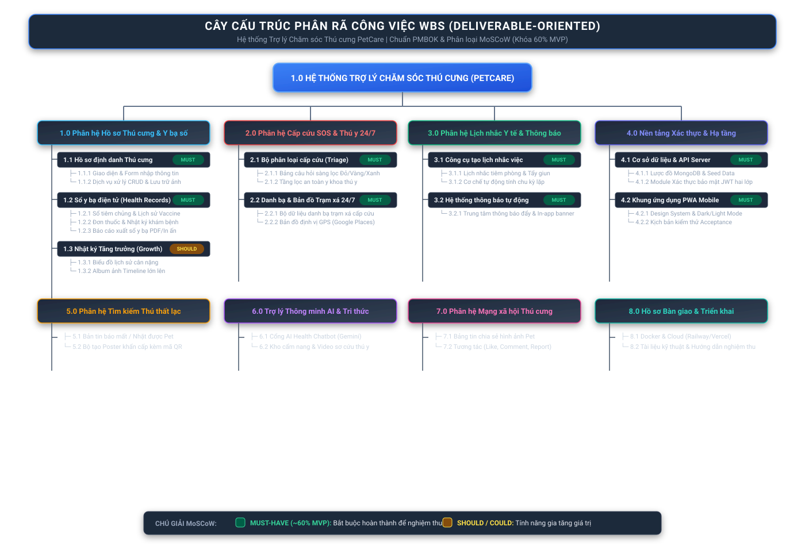

# BÁO CÁO PHẠM VI DỰ ÁN & CẤU TRÚC PHÂN RÃ CÔNG VIỆC (WBS)
## DỰ ÁN: PETCARE ASSISTANT - HỆ THỐNG TRỢ LÝ CHĂM SÓC THÚ CƯNG
**Học phần:** Quản lý Dự án Phần mềm  
**Giảng viên hướng dẫn:** Thầy Nguyễn Thanh Tuấn  
**Mã báo cáo:** Milestone Week 03 - Scope & WBS Report  
**Ngày cập nhật:** 18/10/2026  

---

## 1. SƠ ĐỒ CÂY CẤU TRÚC PHÂN RÃ CÔNG VIỆC (DELIVERABLE-ORIENTED WBS)

> **Ghi chú tuân thủ phương pháp luận PMBOK:**  
> Cây WBS được phân rã hoàn toàn theo **Kết quả đầu ra / Sản phẩm bàn giao (Deliverable-oriented)**, sử dụng danh từ/cụm danh từ cho các phân hệ và gói công việc, tuyệt đối không phân rã theo thì động từ hay các giai đoạn quy trình thác nước (Waterfall: Thiết kế -> Lập trình -> Kiểm thử).

### 1.1 Sơ đồ Đồ họa Trực quan (Vector Diagram)



*(Nếu bạn xem trên trình duyệt hoặc VS Code Markdown Preview, sơ đồ hình ảnh trên sẽ hiển thị trực quan đầy đủ phân nhánh màu sắc).*

---

### 1.2 Cây Cấu trúc Phân cấp Văn bản (Text Hierarchy Tree)

```text
1.0 HỆ THỐNG TRỢ LÝ CHĂM SÓC THÚ CƯNG (PETCARE)
├── 1.0 Phân hệ Hồ sơ Thú cưng & Y bạ số [MUST-HAVE / MVP]
│   ├── 1.1 Hồ sơ định danh Thú cưng
│   │   ├── 1.1.1 Giao diện & Form nhập thông tin Thú cưng
│   │   └── 1.1.2 Dịch vụ xử lý CRUD & Lưu trữ ảnh Pet
│   ├── 1.2 Sổ y bạ điện tử (Digital Health Record)
│   │   ├── 1.2.1 Sổ tiêm chủng & Lịch sử Vaccine
│   │   ├── 1.2.2 Đơn thuốc & Nhật ký khám chữa bệnh
│   │   └── 1.2.3 Báo cáo xuất sổ y bạ PDF/In ấn
│   └── 1.3 Nhật ký Tăng trưởng (Growth Tracker) [SHOULD-HAVE]
│       ├── 1.3.1 Biểu đồ lịch sử cân nặng trực quan
│       └── 1.3.2 Album ảnh Timeline quá trình lớn lên
├── 2.0 Phân hệ Cấp cứu SOS & Danh bạ Thú y 24/7 [MUST-HAVE / MVP]
│   ├── 2.1 Bộ phân loại cấp cứu (Triage Engine)
│   │   ├── 2.1.1 Bảng câu hỏi sàng lọc mức độ khẩn cấp (Đỏ/Vàng/Xanh)
│   │   └── 2.1.2 Tầng lọc an toàn y khoa thú y (Veterinary Safety Guard)
│   └── 2.2 Danh bạ & Bản đồ Trạm xá 24/7
│       ├── 2.2.1 Bộ dữ liệu danh bạ trạm xá cấp cứu & thú y
│       └── 2.2.2 Bản đồ định vị lân cận theo GPS (Google Places)
├── 3.0 Phân hệ Lịch nhắc Y tế & Thông báo [MUST-HAVE / MVP]
│   ├── 3.1 Công cụ tạo lịch nhắc việc chăm sóc
│   │   ├── 3.1.1 Lịch nhắc tiêm phòng & Tẩy giun định kỳ
│   │   └── 3.1.2 Cơ chế tự động tính chu kỳ lặp (Daily/Weekly/Monthly)
│   └── 3.2 Hệ thống thông báo tự động
│       └── 3.2.1 Trung tâm thông báo đẩy & Banner trong ứng dụng
├── 4.0 Nền tảng Xác thực & Hạ tầng Dữ liệu [MUST-HAVE / MVP]
│   ├── 4.1 Hạ tầng Cơ sở dữ liệu & API Gateway
│   │   ├── 4.1.1 Lược đồ MongoDB Schema & Bộ nạp dữ liệu mẫu (Seed Data)
│   │   └── 4.1.2 Module Xác thực bảo mật JWT hai lớp (Access/Refresh)
│   └── 4.2 Khung ứng dụng PWA Mobile-First
│       ├── 4.2.1 Hệ thống Design System & Theme Dark/Light
│       └── 4.2.2 Bộ kiểm thử tích hợp & Kịch bản Acceptance Criteria
├── 5.0 Phân hệ Hỗ trợ Tìm kiếm Thú thất lạc [SHOULD-HAVE]
│   ├── 5.1 Bản tin báo mất / Nhặt được thú cưng
│   └── 5.2 Bộ tạo Poster thất lạc khẩn cấp kèm mã QR cá nhân
├── 6.0 Phân hệ Trợ lý Thông minh AI & Tri thức [SHOULD-HAVE]
│   ├── 6.1 Cổng giao tiếp AI Health Chatbot (Google Gemini)
│   └── 6.2 Kho cẩm nang & Video chăm sóc y khoa chuẩn hóa
├── 7.0 Phân hệ Mạng xã hội Thú cưng [COULD-HAVE]
│   ├── 7.1 Bảng tin chia sẻ hình ảnh & Khoảnh khắc thú cưng
│   └── 7.2 Tương tác cộng đồng (Like, Bình luận, Bookmark, Báo cáo)
└── 8.0 Hồ sơ Bàn giao & Triển khai Hệ thống [MUST-HAVE / MVP]
    ├── 8.1 Đóng gói Docker Container & Triển khai Cloud (Railway / Vercel)
    └── 8.2 Bộ tài liệu kỹ thuật, Hướng dẫn sử dụng & Kịch bản nghiệm thu
```

---

### 1.3 Mã nguồn Sơ đồ Mermaid (Dành cho GitHub / Notion / Draw.io)

    %% Level 3: 1.0 Phân hệ Hồ sơ Thú cưng
    D1 --> D11["1.1 Hồ sơ định danh Thú cưng"]
    D11 --> D111["1.1.1 Giao diện & Form nhập thông tin Thú cưng"]
    D11 --> D112["1.1.2 Dịch vụ xử lý CRUD & Lưu trữ ảnh Pet"]
    D1 --> D12["1.2 Sổ y bạ điện tử (Digital Health Record)"]
    D12 --> D121["1.2.1 Sổ tiêm chủng & Lịch sử Vaccine"]
    D12 --> D122["1.2.2 Đơn thuốc & Nhật ký khám chữa bệnh"]
    D12 --> D123["1.2.3 Báo cáo xuất sổ y bạ PDF/In ấn"]
    D1 --> D13["1.3 Nhật ký Tăng trưởng (Growth Tracker)"]
    D13 --> D131["1.3.1 Biểu đồ lịch sử cân nặng trực quan"]
    D13 --> D132["1.3.2 Album ảnh Timeline quá trình lớn lên"]

    %% Level 3: 2.0 Phân hệ Cấp cứu & Danh bạ
    D2 --> D21["2.1 Bộ phân loại cấp cứu (Triage Engine)"]
    D21 --> D211["2.1.1 Bảng câu hỏi sàng lọc mức độ khẩn cấp (Đỏ/Vàng/Xanh)"]
    D21 --> D212["2.1.2 Tầng lọc an toàn y khoa thú y (Veterinary Safety Guard)"]
    D2 --> D22["2.2 Danh bạ & Bản đồ Trạm xá 24/7"]
    D22 --> D221["2.2.1 Bộ dữ liệu danh bạ trạm xá cấp cứu & thú y"]
    D22 --> D222["2.2.2 Bản đồ định vị lân cận theo GPS (Google Places)"]

    %% Level 3: 3.0 Phân hệ Lịch nhắc
    D3 --> D31["3.1 Công cụ tạo lịch nhắc việc chăm sóc"]
    D31 --> D311["3.1.1 Lịch nhắc tiêm phòng & Tẩy giun định kỳ"]
    D31 --> D312["3.1.2 Cơ chế tự động tính chu kỳ lặp (Daily/Weekly/Monthly)"]
    D3 --> D32["3.2 Hệ thống thông báo tự động"]
    D32 --> D321["3.2.1 Trung tâm thông báo đẩy & Banner trong ứng dụng"]

    %% Level 3: 4.0 Nền tảng Xác thực & Hạ tầng
    D4 --> D41["4.1 Hạ tầng Cơ sở dữ liệu & API Gateway"]
    D41 --> D411["4.1.1 Lược đồ MongoDB Schema & Bộ nạp dữ liệu mẫu (Seed Data)"]
    D41 --> D412["4.1.2 Module Xác thực bảo mật JWT hai lớp (Access/Refresh)"]
    D4 --> D42["4.2 Khung ứng dụng PWA Mobile-First"]
    D42 --> D421["4.2.1 Hệ thống Design System & Theme Dark/Light"]
    D42 --> D422["4.2.2 Bộ kiểm thử tích hợp & Kịch bản Acceptance Criteria"]

    %% Level 3: 5.0 Tìm thú thất lạc
    D5 --> D51["5.1 Bản tin báo mất / Nhặt được thú cưng"]
    D5 --> D52["5.2 Bộ tạo Poster thất lạc khẩn cấp kèm mã QR cá nhân"]

    %% Level 3: 6.0 Trợ lý AI & Tri thức
    D6 --> D61["6.1 Cổng giao tiếp AI Health Chatbot (Google Gemini)"]
    D6 --> D62["6.2 Kho cẩm nang & Video chăm sóc y khoa chuẩn hóa"]

    %% Level 3: 7.0 Mạng xã hội Thú cưng
    D7 --> D71["7.1 Bảng tin chia sẻ hình ảnh & Khoảnh khắc thú cưng"]
    D7 --> D72["7.2 Tương tác cộng đồng (Like, Bình luận, Bookmark, Báo cáo)"]

    %% Level 3: 8.0 Bàn giao & Triển khai
    D8 --> D81["8.1 Đóng gói Docker Container & Triển khai Cloud (Railway / Vercel)"]
    D8 --> D82["8.2 Bộ tài liệu kỹ thuật, Hướng dẫn sử dụng & Kịch bản nghiệm thu"]
```

---

## 2. BẢNG PHÂN LOẠI PHẠM VI THEO MÔ HÌNH MOSCOW (KHÓA 60% MVP)

Mô hình MoSCoW phân loại rành mạch các gói công việc nhằm đảm bảo tỷ trọng **Minimum Viable Product (MVP) đạt đúng tỷ lệ vàng ~60%**, bảo vệ nhóm khỏi tình trạng trôi dạt phạm vi (Scope Creep) và cam kết giao nộp sản phẩm hoạt động được đúng hạn.

| Phân loại | Tỷ trọng | Mã WBS Gói công việc | Diễn giải cam kết bàn giao |
| :--- | :---: | :--- | :--- |
| **MUST-HAVE**<br>*(Bắt buộc - Khóa 60% MVP)* | **~60%** | • **1.1.1 & 1.1.2:** Giao diện & Form hồ sơ thú cưng cơ bản.<br>• **1.2.1 & 1.2.2:** Sổ theo dõi tiêm phòng & đơn thuốc điều trị.<br>• **2.1.1 & 2.1.2:** Triage phân loại triệu chứng khẩn cấp & Tầng an toàn thú y.<br>• **2.2.1 & 2.2.2:** Danh bạ trạm xá cấp cứu 24/7 kết nối vị trí thật.<br>• **3.1.1 & 3.1.2:** Lịch nhắc tiêm phòng tự động tính chu kỳ hẹn tiếp theo.<br>• **4.1.1 & 4.1.2:** Thiết kế Database Schema, API Server & Xác thực JWT.<br>• **4.2.1:** Khung giao diện PWA Mobile-First responsive.<br>• **8.1:** Triển khai chạy thực tế trên Cloud (Railway Backend + Vercel PWA). | **Điều kiện tiên quyết để nghiệm thu:** Nếu thiếu bất kỳ gói nào trong nhóm này, hệ thống bị coi là chưa đáp ứng mục tiêu cốt lõi của ứng dụng y tế thú cưng và không được nghiệm thu. |
| **SHOULD-HAVE**<br>*(Nên có - Giá trị gia tăng)* | **~20%** | • **1.3.1:** Biểu đồ trực quan hóa lịch sử tăng trưởng cân nặng.<br>• **5.1 & 5.2:** Bản tin tìm thú cưng thất lạc & Bộ tự động xuất Poster kèm mã QR.<br>• **6.1:** Trợ lý ảo AI sức khỏe (Google Gemini integration có guardrail).<br>• **1.2.3:** Tính năng xuất sổ y bạ số sang bản in/PDF tóm tắt. | Được kích hoạt triển khai ngay khi toàn bộ các gói Must-Have đã vượt qua Acceptance Criteria trong Sprint 1 và Sprint 2. |
| **COULD-HAVE**<br>*(Có thể có - Mở rộng trải nghiệm)* | **~15%** | • **1.3.2:** Album ảnh Timeline quá trình lớn lên của thú cưng.<br>• **6.2:** Thư viện video hướng dẫn sơ cứu thú y sinh động.<br>• **7.1 & 7.2:** Mạng xã hội cộng đồng (Đăng bài, bình luận, thả tim, đánh dấu). | Chỉ phát triển khi còn dư thời gian (Buffer Time) ở các chặng nước rút cuối kỳ. |
| **WON'T-HAVE**<br>*(Loại bỏ khỏi phạm vi đợt này)* | **~5%** | • Hệ thống sàn thương mại điện tử mua bán thú cưng & phụ kiện.<br>• Cổng thanh toán trực tuyến tiền viện phí (VNPAY / MoMo / Stripe).<br>• Chat trực tiếp Real-time 1:1 qua WebRTC với Bác sĩ thú y (Telemedicine). | Cam kết không phát triển trong đồ án kỳ này nhằm tránh vỡ tiến độ và vi phạm giấy phép hành nghề thú y trực tuyến. |

---

## 3. TỪ ĐIỂN WBS (WBS DICTIONARY) KÈM TIÊU CHÍ NGHIỆM THU RÕ RÀNG (EXPLICIT ACCEPTANCE CRITERIA)

Dưới đây là chi tiết từ điển WBS cho các gói công việc trọng yếu, bao gồm tiêu chí nghiệm thu rõ ràng (*Given - When - Then* hoặc *Checklist kiểm thử định lượng*) giúp kiểm thử viên và giảng viên có thể chấm điểm độc lập.

### Gói công việc 1: [WBS 1.1.1] Giao diện & Form nhập thông tin Thú cưng
- **Thuộc Deliverable:** 1.0 Phân hệ Hồ sơ Thú cưng & Y bạ số
- **Mức ưu tiên MoSCoW:** Must-Have (MVP)
- **Mô tả công việc:** Xây dựng màn hình danh sách thú cưng và Modal/Form thêm mới hồ sơ bé cưng (tên, giống loài: Chó/Mèo, ngày sinh/tuổi, giới tính, trạng thái triệt sản, ảnh đại diện).
- **Kết quả bàn giao (Deliverable):** Component `PetsView.tsx`, Modal tạo hồ sơ, kết nối API `POST /api/v1/pets`.
- **Tiêu chí nghiệm thu cụ thể (Explicit Acceptance Criteria):**
  1. **AC-1.1.1.1 (Validation):** Khi người dùng để trống trường "Tên thú cưng" hoặc "Loài", form phải chặn submit và hiển thị thông báo lỗi màu đỏ ngay dưới ô nhập liệu.
  2. **AC-1.1.1.2 (Lưu trữ thành công):** 
     - *Given:* Người dùng đã đăng nhập và điền đầy đủ: Tên "Milo", Loài "Chó", Giống "Golden Retriever", Ngày sinh hợp lệ.
     - *When:* Bấm nút "Lưu hồ sơ".
     - *Then:* Hệ thống gửi request thành công, nhận mã phản hồi HTTP 201, đóng Modal, hiển thị Toast "Thêm thú cưng thành công" và thẻ thông tin Milo xuất hiện ngay lập tức trên màn hình chính mà không cần tải lại trang.
  3. **AC-1.1.1.3 (Hiển thị Avatar):** Nếu người dùng không upload ảnh đại diện, hệ thống tự động gán icon mặc định tương ứng với loài Chó hoặc Mèo.

---

### Gói công việc 2: [WBS 1.2.1] Sổ tiêm chủng & Lịch sử Vaccine
- **Thuộc Deliverable:** 1.0 Phân hệ Hồ sơ Thú cưng & Y bạ số
- **Mức ưu tiên MoSCoW:** Must-Have (MVP)
- **Mô tả công việc:** Quản lý các mũi vắc xin đã tiêm (tên vắc xin, ngày tiêm, ngày đến hạn tái chủng, cơ sở thú y thực hiện).
- **Kết quả bàn giao (Deliverable):** Module `VaccinationsModule` Backend và giao diện danh sách mũi tiêm trong `HealthView.tsx`.
- **Tiêu chí nghiệm thu cụ thể (Explicit Acceptance Criteria):**
  1. **AC-1.2.1.1 (Phân loại trạng thái mũi tiêm):**
     - Mũi tiêm có ngày tái chủng lớn hơn ngày hiện tại > 30 ngày: Hiển thị nhãn xanh **"Đã tiêm / Còn hiệu lực"**.
     - Mũi tiêm có ngày tái chủng trong vòng 7-30 ngày tới: Hiển thị nhãn vàng cảnh báo **"Sắp đến hẹn tiêm"**.
     - Mũi tiêm quá hạn tái chủng: Hiển thị nhãn đỏ **"Quá hạn tái tiêm"**.
  2. **AC-1.2.1.2 (Liên kết Thú cưng):** Khi chuyển đổi giữa các bé thú cưng khác nhau, danh sách sổ tiêm phải lọc chính xác 100% theo `petId` được chọn, không bị hiển thị chồng chéo dữ liệu của thú cưng khác.

---

### Gói công việc 3: [WBS 2.1.2] Tầng lọc an toàn y khoa thú y (Veterinary Safety Guard)
- **Thuộc Deliverable:** 2.0 Phân hệ Cấp cứu SOS & Danh bạ Thú y 24/7
- **Mức ưu tiên MoSCoW:** Must-Have (MVP)
- **Mô tả công việc:** Triển khai cơ chế rà soát triệu chứng và các truy vấn cấp cứu nhằm ngăn chặn triệt để các hành vi sơ cứu sai lầm gây chết thú cưng (ép uống nước muối, tự ý cho uống Paracetamol, dùng lòng trắng trứng giải bả).
- **Kết quả bàn giao (Deliverable):** `EmergencySafetyService.ts` tích hợp trong luồng xử lý khẩn cấp và AI assistant.
- **Tiêu chí nghiệm thu cụ thể (Explicit Acceptance Criteria):**
  1. **AC-2.1.2.1 (Chặn ngộ độc Paracetamol):** 
     - *Given:* Người dùng nhập triệu chứng sốt và hỏi liều dùng "Paracetamol" hoặc "Panadol" cho chó/mèo.
     - *When:* Hệ thống quét chuỗi truy vấn.
     - *Then:* Hệ thống lập tức trả về cảnh báo nguy cấp cấp độ ĐỎ: *"TUYỆT ĐỐI KHÔNG SỬ DỤNG Paracetamol cho chó mèo - Gây hoại tử gan cấp và tử vong chỉ sau vài giờ"*, đồng thời hiển thị nút bấm gọi ngay trạm xá cấp cứu.
  2. **AC-2.1.2.2 (Chặn sặc nước muối):** Khi phát hiện từ khóa "uống nước muối để nôn", hệ thống phải đưa ra khuyến cáo cấm ép nôn bằng muối do nguy cơ phù não do ngộ độc ion Natri (Hypernatremia).

---

### Gói công việc 4: [WBS 2.2.2] Bản đồ định vị trạm xá lân cận theo GPS (Google Places)
- **Thuộc Deliverable:** 2.0 Phân hệ Cấp cứu SOS & Danh bạ Thú y 24/7
- **Mức ưu tiên MoSCoW:** Must-Have (MVP)
- **Mô tả công việc:** Tích hợp Google Places API (New) và công thức tính khoảng cách Haversine để tra cứu các phòng khám thú y 24/7, bệnh viện thú y gần tọa độ người dùng nhất.
- **Kết quả bàn giao (Deliverable):** Endpoint `GET /api/v1/locations/nearby` và giao diện `LocationsView.tsx`.
- **Tiêu chí nghiệm thu cụ thể (Explicit Acceptance Criteria):**
  1. **AC-2.2.2.1 (Bật GPS & Tìm kiếm):**
     - *Given:* Người dùng cấp quyền truy cập vị trí trên trình duyệt (ví dụ: Đà Nẵng: 16.0771, 108.2039).
     - *When:* Mở tab "Địa điểm" hoặc bấm nút "Cấp cứu 24/7".
     - *Then:* Hệ thống trả về danh sách các cơ sở thú y thật trong bán kính tối đa 15km, sắp xếp tăng dần theo khoảng cách (từ gần nhất đến xa nhất), thời gian phản hồi API < 1000ms.
  2. **AC-2.2.2.2 (Thao tác một chạm):** Mỗi thẻ phòng khám phải có số điện thoại dạng liên kết `tel:xxx` và nút "Chỉ đường" mở trực tiếp Google Maps với tọa độ đích chính xác.

---

### Gói công việc 5: [WBS 3.1.2] Cơ chế tự động tính chu kỳ lặp lịch nhắc việc
- **Thuộc Deliverable:** 3.0 Phân hệ Lịch nhắc Y tế & Thông báo
- **Mức ưu tiên MoSCoW:** Must-Have (MVP)
- **Mô tả công việc:** Xây dựng logic tự động tính ngày nhắc hẹn của chu kỳ tiếp theo khi người dùng đánh dấu hoàn thành một lịch nhắc định kỳ (tẩy giun định kỳ 3 tháng/lần, nhỏ gáy trị ve rận hàng tháng).
- **Kết quả bàn giao (Deliverable):** Endpoint `POST /api/v1/reminders/:id/complete` và component `RemindersView.tsx`.
- **Tiêu chí nghiệm thu cụ thể (Explicit Acceptance Criteria):**
  1. **AC-3.1.2.1 (Tự động dời lịch lặp):**
     - *Given:* Một lịch nhắc "Tẩy giun định kỳ" có chu kỳ `EVERY_3_MONTHS` đến hạn vào ngày `15/10/2026`.
     - *When:* Người dùng bấm nút "Đã hoàn thành".
     - *Then:* Lịch hiện tại được ghi nhận trạng thái hoàn tất, đồng thời hệ thống tự động sinh hoặc dời ngày đến hạn tiếp theo sang đúng ngày `15/01/2027` mà người dùng không cần phải tạo lại nhắc nhở thủ công.
  2. **AC-3.1.2.2 (Thông báo quá hạn):** Lịch nhắc chưa được hoàn thành sau 24h kể từ thời điểm hẹn phải tự động đổi màu sang viền đỏ và hiển thị trạng thái "Đã quá hạn".

---

### Gói công việc 6: [WBS 4.1.2] Module Xác thực bảo mật JWT hai lớp (Access/Refresh)
- **Thuộc Deliverable:** 4.0 Nền tảng Xác thực & Hạ tầng Dữ liệu
- **Mức ưu tiên MoSCoW:** Must-Have (MVP)
- **Mô tả công việc:** Xây dựng quy trình đăng ký, đăng nhập an toàn với mật khẩu mã hóa Bcrypt 10 vòng, cấp phát cặp khóa Access Token (thời hạn 1 ngày) và Refresh Token (thời hạn 7 ngày).
- **Kết quả bàn giao (Deliverable):** `AuthModule` trong NestJS, `AuthModal.tsx` và `apiClient.ts` tự động refresh token trên Frontend.
- **Tiêu chí nghiệm thu cụ thể (Explicit Acceptance Criteria):**
  1. **AC-4.1.2.1 (Đăng nhập hợp lệ):** Nhập đúng Email và Mật khẩu hợp lệ trả về HTTP 200 kèm access token, thông tin `user` và lưu trữ trạng thái đăng nhập vào LocalStorage.
  2. **AC-4.1.2.2 (Chặn truy cập trái phép):** Gửi request đến các route được bảo vệ (ví dụ: `/pets`, `/health-records`) mà không đính kèm Bearer Token hợp lệ phải nhận về mã lỗi HTTP 401 Unauthorized.
  3. **AC-4.1.2.3 (Tự động gia hạn phiên làm việc):** Khi Access Token hết hạn, Axios Interceptor ở Frontend phải tự động gọi ngầm endpoint `/auth/refresh` bằng Refresh Token để lấy Access Token mới và gửi lại request ban đầu mà không làm gián đoạn trải nghiệm người dùng.

---

## 4. MA TRẬN TRUY XUẤT YÊU CẦU ĐỒNG BỘ LÊN JIRA BACKLOG (WBS TO JIRA MAPPING)

Bảng này cung cấp bản ánh xạ chuẩn xác giữa các **Work Package của WBS** và các **User Story / Task trên Jira Backlog**, phục vụ việc nhập liệu trực tiếp lên Jira Board của nhóm:

| Mã Jira Issue | Mã WBS | Tên Task / User Story trên Jira | Loại Issue | Story Points | Sprint | Assignee gợi ý | Acceptance Criteria tóm tắt |
| :--- | :--- | :--- | :---: | :---: | :---: | :---: | :--- |
| **SCRUM-5** | **WBS 4.1.1** | Thiết kế Database Schema & Khởi tạo API Server | Story | **5** | Sprint 1 | HL | Schema hoàn chỉnh cho User, Pet, Record; chạy seed data 100% pass |
| **SCRUM-6** | **WBS 4.1.2** | Xây dựng chức năng Xác thực (Login / Register) | Story | **3** | Sprint 1 | T | Cấp JWT Token, mã hóa mật khẩu Bcrypt, chặn route riêng tư |
| **SCRUM-7** | **WBS 1.1.1** | Giao diện & Form nhập thông tin Thú cưng | Story | **5** | Sprint 1 | HH | Form có validate, hiển thị danh sách thẻ Pet, lưu thành công |
| **SCRUM-8** | **WBS 2.2.1** | Thu thập dữ liệu & Danh bạ phòng khám thú y 24/7 | Task | **3** | Sprint 1 | LK | Có tối thiểu 20 địa điểm thú y thực tế, có số hotline và địa chỉ |
| **SCRUM-9** | **WBS 4.2.1** | Viết kịch bản kiểm thử Acceptance Criteria Sprint 1 | Task | **3** | Sprint 1 | D | Bộ test case kiểm tra AC-1.1.1, AC-4.1.2, AC-2.2.1 đầy đủ Pass/Fail |
| **SCRUM-10**| **WBS 2.1.2** | Triển khai Bộ lọc an toàn Thú y & Cấp cứu SOS | Story | **5** | Sprint 2 | HL | Chặn mẹo Paracetamol, ép nước muối; phân loại màu Red/Yellow |
| **SCRUM-11**| **WBS 1.2.1** | Quản lý Sổ tiêm chủng & Lịch hẹn Vaccine | Story | **5** | Sprint 2 | HH | Cảnh báo mũi tiêm sắp đến hẹn (7-30 ngày), phân màu trạng thái |
| **SCRUM-12**| **WBS 3.1.2** | Tự động hóa lịch nhắc chu kỳ lặp lại | Story | **3** | Sprint 2 | T | Bấm hoàn thành tự tính ngày chu kỳ tiếp theo (+1 tháng, +3 tháng) |
| **SCRUM-13**| **WBS 2.2.2** | Tích hợp Google Places hiển thị trạm xá gần nhất | Story | **5** | Sprint 2 | LK | Nhận GPS thiết bị, tính khoảng cách km, nút gọi điện khẩn cấp |
| **SCRUM-14**| **WBS 8.1**   | Thiết lập CI/CD & Triển khai Railway/Vercel | Task | **3** | Sprint 2 | D | Deploy tự động khi commit, Web chạy HTTPS mượt mà không lỗi |
